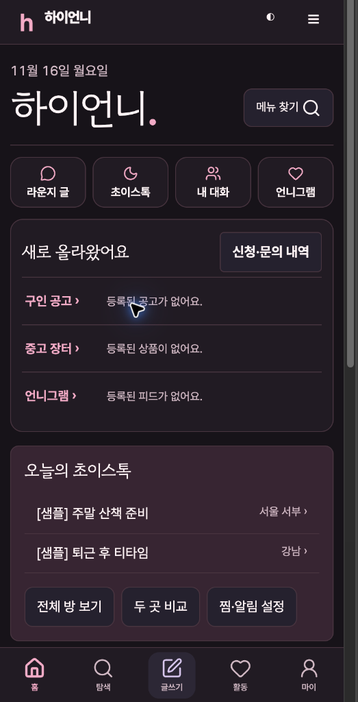
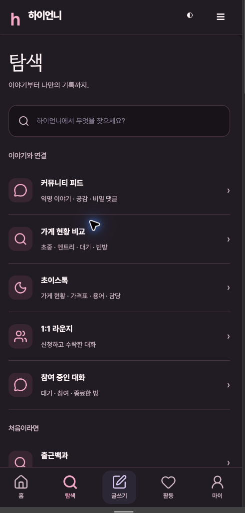
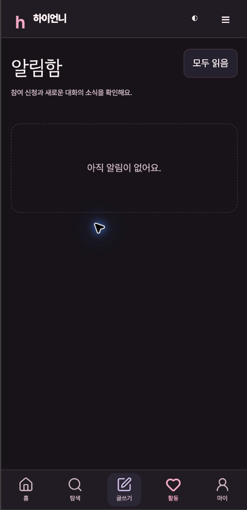
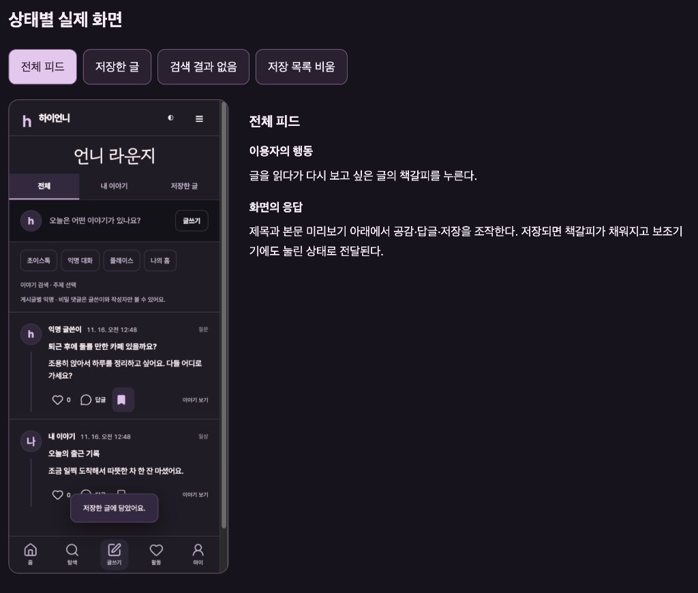
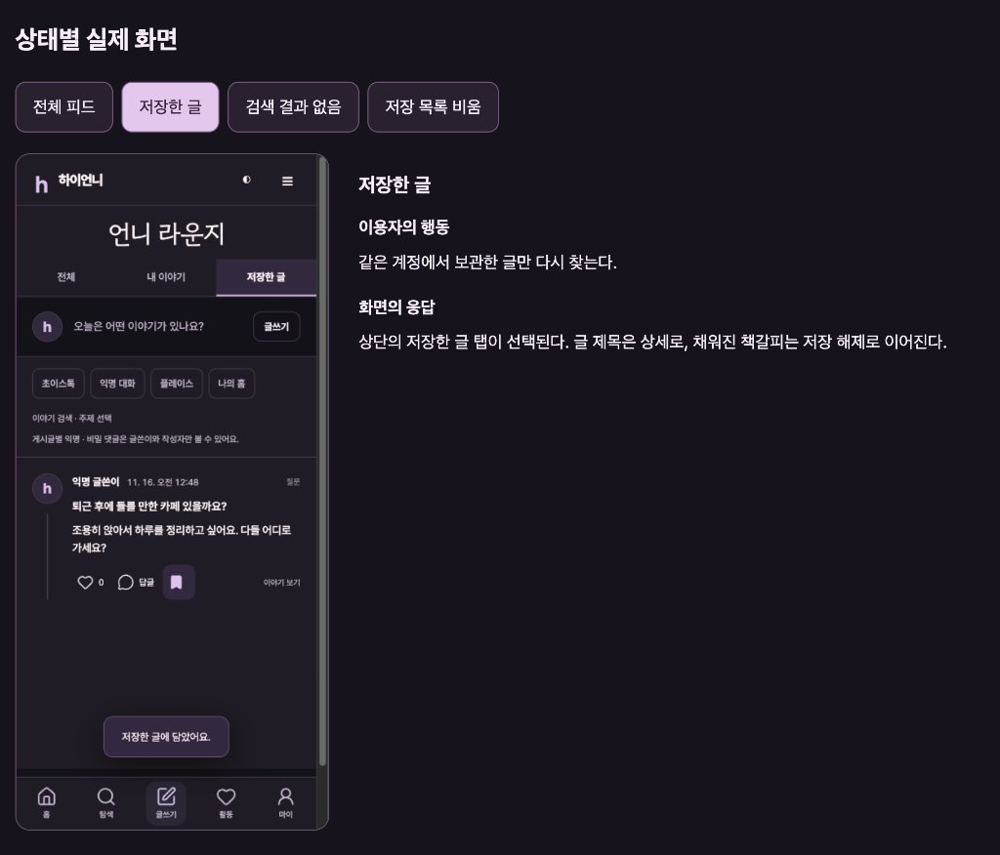

# UIX Example Gallery

This folder contains the UI/UX example images you provided.

---

## Screenshots & Visual References

| Image | Description |
|-------|-------------|
|  | (placeholder description) |
|  | |
|  | |
|  | |
|  | |
|  | |
|  | |
|  | |
|  | |
|  | |
|  | |
|  | |
|  | |
|  | |
|  | |

---

*All images are stored locally in this `design` folder. Open the markdown file in VS Code to view the gallery.*